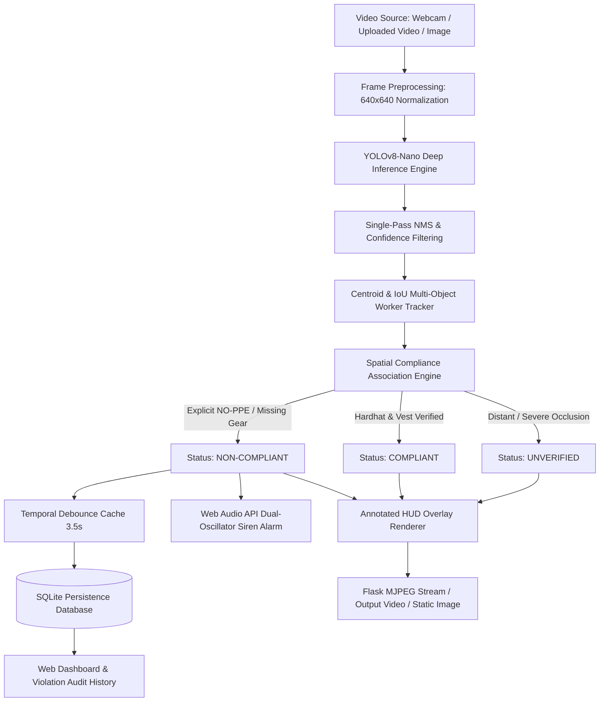
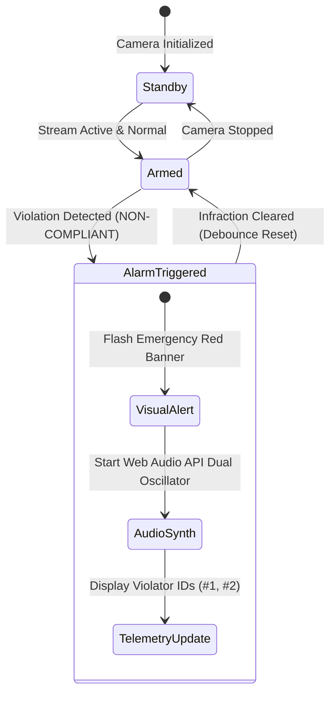

# SiteGuard AI: Real-Time PPE and Construction Site Safety Compliance Detection System

[](https://www.python.org/)
[](https://ultralytics.com)
[](https://pytorch.org/)
[](https://flask.palletsprojects.com/)
[](https://www.sqlite.org/)
[](https://developer.nvidia.com/cuda-zone)
[](LICENSE)

**SiteGuard AI** is an end-to-end, computer vision-powered workplace safety monitoring and compliance enforcement platform. Engineered for dynamic industrial and construction environments, SiteGuard AI continuously monitors workers, verifies the active wearing of mandatory Personal Protective Equipment (PPE) including **Hardhats/Helmets**, **Safety Vests**, **Masks**, **Gloves**, **Boots**, and **Goggles**, triggers instant **audible acoustic alarms** upon infractions, logs safety violations to an SQLite database with anti-duplication debouncing, and presents telemetry on an interactive web dashboard.

---

## Table of Contents

- [Key Features](#key-features)
- [System Architecture](#system-architecture)
- [Spatial Compliance Association Logic](#spatial-compliance-association-logic)
- [Audible Alarm & Real-Time Alert System](#audible-alarm--real-time-alert-system)
- [Dataset Architecture & Class Mapping](#dataset-architecture--class-mapping)
- [Model Architecture & Training Details](#model-architecture--training-details)
- [Evaluation & Benchmark Results](#evaluation--benchmark-results)
- [NMS IoU Threshold Comparison](#nms-iou-threshold-comparison)
- [Project Directory Layout](#project-directory-layout)
- [Installation & Environment Setup](#installation--environment-setup)
- [Web Application Walkthrough](#web-application-walkthrough)
- [REST API Specification](#rest-api-specification)
- [Database Schema & Anti-Duplication Debouncing](#database-schema--anti-duplication-debouncing)
- [Developer & CLI Scripts](#developer--cli-scripts)
- [Troubleshooting & FAQ](#troubleshooting--faq)
- [License](#license)

---

## Key Features

- **Real-Time Video Stream Inference**: Low-latency multipart MJPEG streaming with annotated bounding boxes, class labels, confidence scores, and persistent worker IDs.
- **Sudden Safety Violation Alarm**: Integrated browser Web Audio API acoustic synthesizer that sounds a dual-oscillator emergency siren when a violation occurs, coupled with a flashing visual emergency banner.
- **Centroid & IoU Multi-Worker Tracking**: Persistent worker ID tracking (`Worker #1`, `Worker #2`, etc.) across video frames with trajectory smoothing, preventing redundant violation counts.
- **Localized Spatial Body-Part Association**: Anatomical bounding sub-regions (Head, Eyes, Torso, Hands, Feet) verify whether PPE is physically worn by a worker rather than resting on scaffolds or the ground.
- **Tri-State Compliance Decision Engine**:
  - `COMPLIANT` (Green): Mandatory safety gear (Hardhat and Vest) verified.
  - `NON-COMPLIANT` (Red): Explicit negative class detected (`NO-Hardhat`, `NO-Safety Vest`) or required gear missing on a clearly visible worker.
  - `UNVERIFIED` (Amber): Worker is occluded, distant, or box height is below resolution threshold ($<65\text{ px}$), preventing false alarms.
- **Static Image Safety Analysis**: Upload site photographs (`.jpg`, `.jpeg`, `.png`, `.webp`, `.bmp`) for instant AI analysis, detailed per-worker compliance breakdowns, and high-resolution annotated image downloads.
- **Batch Video Processing**: Upload recorded inspection footage (`.mp4`, `.avi`, `.mov`, `.mkv`), process all frames through YOLOv8, track frame-by-frame compliance, and download annotated output files.
- **Debounced SQLite Audit Logging**: Automatic recording of detection events and infractions with a temporal debouncing cache (3.5-second cooldown per worker-violation pair) to eliminate log flooding.
- **Modern Dark-Slate Web Interface**: Clean, responsive UI with real-time KPI metrics, live webcam streaming, violation history tables, and zero external CSS bloat.

---

## System Architecture

SiteGuard AI processes visual inputs through a decoupled pipeline separating deep inference, object tracking, geometric validation, persistence, and presentation:



---

## Spatial Compliance Association Logic

Standard object detectors cannot determine whether a detected helmet belongs to a specific worker or simply lies on a nearby surface. SiteGuard AI implements localized anatomical bounding sub-regions derived from each worker's bounding box $[x_1, y_1, x_2, y_2]$ with width $W$ and height $H$:

```
Worker Bounding Box
┌──────────────────────────────────────────────┐
│  HEAD REGION: [x1 - 0.05W, y1 - 0.15H,       │  ──> Hardhat / NO-Hardhat
│                x2 + 0.05W, y1 + 0.35H]       │
├──────────────────────────────────────────────┤
│  EYE REGION:  [x1 - 0.05W, y1 + 0.05H,       │  ──> Goggles / NO-Goggles
│                x2 + 0.05W, y1 + 0.30H]       │
├──────────────────────────────────────────────┤
│  TORSO REGION:[x1 - 0.05W, y1 + 0.20H,       │  ──> Safety Vest / NO-Safety Vest
│                x2 + 0.05W, y1 + 0.75H]       │
├──────────────────────────────────────────────┤
│  HAND REGION: [x1 - 0.12W, y1 + 0.40H,       │  ──> Gloves / NO-Gloves
│                x2 + 0.12W, y2 + 0.05H]       │
├──────────────────────────────────────────────┤
│  FOOT REGION: [x1 - 0.08W, y1 + 0.75H,       │  ──> Boots / NO-Boots
│                x2 + 0.08W, y2 + 0.15H]       │
└──────────────────────────────────────────────┘
```

### Evaluation Hierarchy:
1. **Explicit Negative Detections**: If a `NO-Hardhat` or `NO-Safety Vest` prediction intersects the respective body sub-region ($\text{IoU} > 0.20$ or center-point contained), the worker is immediately classified as **NON-COMPLIANT**.
2. **Positive Confirmations**: If a positive `Hardhat` or `Safety Vest` intersects the region, the item is registered as **WORN**.
3. **Implicit Violations**: If neither positive nor explicit negative is detected, but the worker is clearly resolved ($H \ge 65\text{ px}, W \ge 30\text{ px}$), the item is flagged as a violation.
4. **Resolution Guard**: Distant workers ($H < 65\text{ px}$) are marked **UNVERIFIED** to avoid penalizing workers due to sensor resolution limitations.
5. **Close-up Fallback**: In extreme close-up webcam views where the full body detector does not trigger, detected PPE items automatically infer worker bounds.

---

## Audible Alarm & Real-Time Alert System

SiteGuard AI features an integrated acoustic emergency warning system running natively in the browser:



- **Audio Synthesizer**: Uses the browser's native `AudioContext` with dual oscillators (880 Hz alternating with 620 Hz at 5.5 Hz modulation) to generate an unmistakable industrial siren without external MP3 dependencies.
- **Client Controls**: Operators can mute or unmute the audio siren at any time or trigger a 1.5-second test alarm.
- **High-Visibility Banner**: Displays the exact IDs of non-compliant workers in real time (e.g. `⚠️ SAFETY VIOLATION DETECTED: Worker #1 (Missing Helmet)`).

---

## Dataset Architecture & Class Mapping

SiteGuard AI supports two standardized dataset schemas:

### 1. Construction Site Safety (CSS) v30 (Primary)
- **Source**: Roboflow Universe `construction-site-safety/30`
- **Total Images**: 717 | **Total Bounding Boxes**: 5,570 | **Corrupted Labels**: 0 (100% verified)
- **Split Distribution**:
  - `Train`: 521 images, 521 label files
  - `Validation`: 114 images, 114 label files
  - `Test`: 82 images, 82 label files

| Class ID | Class Name | Category | Class ID | Class Name | Category |
|:---:|:---|:---|:---:|:---|:---|
| 0 | `Excavator` | Machinery | 13 | `dump truck` | Machinery |
| 1 | `Gloves` | PPE | 14 | `fire hydrant` | Site Asset |
| 2 | `Hardhat` | Mandatory PPE | 15 | `machinery` | Machinery |
| 3 | `Ladder` | Equipment | 16 | `mini-van` | Vehicle |
| 4 | `Mask` | PPE | 17 | `sedan` | Vehicle |
| 5 | `NO-Hardhat` | Violation | 18 | `semi` | Vehicle |
| 6 | `NO-Mask` | Violation | 19 | `trailer` | Vehicle |
| 7 | `NO-Safety Vest` | Violation | 20 | `truck and trailer`| Vehicle |
| 8 | `Person` | Worker | 21 | `truck` | Vehicle |
| 9 | `SUV` | Vehicle | 22 | `van` | Vehicle |
| 10 | `Safety Cone` | Safety Asset | 23 | `vehicle` | Vehicle |
| 11 | `Safety Vest` | Mandatory PPE | 24 | `wheel loader` | Machinery |
| 12 | `bus` | Vehicle | | | |

### 2. Combined PPE Extended Dataset (`dataset_ppe/`)
SiteGuard AI's compliance engine is cross-compatible with 11-class PPE datasets containing `helmet`, `gloves`, `vest`, `boots`, `goggles`, `Person`, and negative classes `no_helmet`, `no_goggle`, `no_gloves`, `no_boots`.

---

## Model Architecture & Training Details

- **Base Network**: YOLOv8-Nano (`yolov8n.pt`)
- **Parameters**: 3.15 Million | **GFLOPs**: 8.7
- **Backbone**: Modified CSPDarknet53 with C2f (Cross-Stage Partial with 2 Convolutions) modules.
- **Neck**: PANet (Path Aggregation Network) providing multi-scale pyramid feature fusion.
- **Head**: Decoupled anchor-free prediction head separating classification and box regression.
- **Loss Formulation**: Task-Aligned Assigner combining Complete IoU (CIoU), Distribution Focal Loss (DFL), and Binary Cross-Entropy (BCE).

### Training Hyperparameters:
```bash
python scripts/train.py --epochs 35 --batch 16 --imgsz 640 --device 0
```
- **Optimizer**: AdamW / Auto with cosine learning rate scheduling
- **Input Resolution**: $640 \times 640$ pixels
- **Batch Size**: 16
- **Checkpoint Outputs**: Automatically saved to `models/best.pt` and `models/last.pt`

---

## Evaluation & Benchmark Results

### Model Performance on Unseen Test Split (`best.pt`)

Evaluated using `scripts/evaluate.py --split test`:

| Metric | Overall Score |
|:---|:---:|
| **Precision (P)** | **51.8%** (0.5178) |
| **Recall (R)** | **38.6%** (0.3864) |
| **mAP@0.5** | **38.3%** (0.3828) |
| **mAP@0.5:0.95** | **25.3%** (0.2525) |

#### Core Safety Class Breakdown:

| Class ID | Class Name | Precision (P) | Recall (R) | mAP@0.5 |
|:---:|:---|:---:|:---:|:---:|
| 2 | `Hardhat` | **87.9%** | **59.5%** | **70.0%** |
| 8 | `Person` | **76.0%** | **69.3%** | **75.2%** |
| 11 | `Safety Vest` | **61.4%** | **65.4%** | **64.9%** |
| 7 | `NO-Safety Vest` | **65.3%** | **48.1%** | **50.1%** |
| 5 | `NO-Hardhat` | **51.9%** | **50.0%** | **36.8%** |
| 4 | `Mask` | **65.6%** | **64.3%** | **57.9%** |
| 0 | `Excavator` | **54.2%** | **77.8%** | **62.7%** |
| 10 | `Safety Cone` | **62.6%** | **59.0%** | **60.0%** |

### Latency & Throughput Benchmark

Benchmarked using `scripts/benchmark.py --frames 50`:

| Platform / Hardware | Pure Inference Latency | Pure Inference FPS | Total Application FPS |
|:---|:---:|:---:|:---:|
| **NVIDIA RTX 3050 Laptop GPU (6GB VRAM)** | **18.2 ms** | **~55.0 FPS** | **35.0 – 45.0 FPS** |
| **Intel Core i5 (13th Gen, CPU Fallback)** | **47.9 ms** | **20.9 FPS** | **20.9 FPS** |

> **Note on FPS Distinction**:
> - **Pure Inference FPS**: Measures neural network forward-pass and NMS execution.
> - **Total Application FPS**: End-to-end throughput including camera frame capture, preprocessing, YOLOv8 inference, multi-worker tracking, geometric compliance association, HUD drawing, and MJPEG encoding.

---

## NMS IoU Threshold Comparison

An empirical investigation was conducted across multiple Non-Maximum Suppression (NMS) IoU thresholds on the test set (`scripts/compare_nms.py`):

| NMS IoU Threshold | Precision | Recall | mAP@0.5 | mAP@0.5:0.95 | Inference Latency | Inference FPS |
|:---:|:---:|:---:|:---:|:---:|:---:|:---:|
| **0.30** | 0.504 | 0.321 | 0.283 | 0.189 | 35.5 ms | 27.8 FPS |
| **0.45 (Default)** | **0.498** | **0.325** | **0.286** | **0.190** | **36.1 ms** | **27.4 FPS** |
| **0.60** | 0.482 | 0.327 | 0.284 | 0.189 | 38.7 ms | 25.4 FPS |
| **0.70** | 0.466 | 0.329 | 0.283 | 0.193 | 37.6 ms | 26.0 FPS |

### Analysis:
- **NMS IoU = 0.30**: Aggressively eliminates overlapping boxes, but risks suppressing adjacent workers or small PPE items located near worker boundaries.
- **NMS IoU = 0.45**: Optimal sweet spot maximizing mAP@0.5 and maintaining clean bounding box separation without redundant duplicates. Selected as the default for SiteGuard AI.
- **NMS IoU = 0.60 – 0.70**: Retains overlapping predictions, occasionally generating duplicate bounding boxes for a single individual in dense scenes.

---

## Project Directory Layout

```
SiteGuard-AI/
│
├── app.py                      # Flask web application, streaming & API routes
├── config.py                   # Central configuration, paths, classes & thresholds
├── requirements.txt            # Python dependencies
├── README.md                   # Comprehensive project documentation
├── test_video_pipeline.py      # End-to-end video pipeline verification script
│
├── database/
│   ├── __init__.py
│   └── db.py                   # SQLite tables, debounce logic & audit queries
│
├── detection/
│   ├── __init__.py
│   ├── detector.py             # YOLOv8 detector & annotated HUD visualizer
│   ├── compliance.py           # Spatial body-part PPE compliance engine
│   ├── tracker.py              # Centroid & IoU worker tracking
│   └── nms.py                  # Single-pass NMS inference wrapper
│
├── models/
│   ├── best.pt                 # Fine-tuned YOLOv8-nano weights (6.2 MB)
│   ├── last.pt                 # Training checkpoint weights
│   └── yolov8n.pt              # Base pretrained YOLOv8-nano weights
│
├── dataset/                    # Primary Roboflow CSS v30 Dataset
│   ├── data.yaml               # Dataset configuration (25 classes)
│   ├── train/                  # 521 training images & labels
│   ├── valid/                  # 114 validation images & labels
│   └── test/                   # 82 testing images & labels
│
├── dataset_ppe/                # Extended 11-Class PPE Dataset
│   ├── data.yaml               # PPE dataset configuration
│   ├── images/                 # Train, val, test image splits
│   └── labels/                 # Annotation text files
│
├── scripts/
│   ├── inspect_dataset.py      # Dataset validation & class breakdown script
│   ├── train.py                # Model training & fine-tuning script
│   ├── evaluate.py             # Split evaluation & metrics calculation
│   ├── benchmark.py            # Latency & FPS benchmarking utility
│   ├── compare_nms.py          # Empirical NMS IoU comparison tool
│   └── create_sample_video.py  # Synthetic test video generator
│
├── templates/
│   ├── base.html               # Base layout, sidebar & navigation
│   ├── index.html              # Main KPI dashboard & recent infractions
│   ├── live_detection.html     # Live camera monitor & audible siren alarm
│   ├── image_detection.html    # Static image safety analysis & export
│   ├── upload.html             # Video file upload & processing queue
│   └── history.html            # Complete violation audit log
│
├── static/
│   ├── css/style.css           # Custom dark-slate design system stylesheet
│   └── js/main.js              # Polling, Web Audio API synth & async handlers
│
├── uploads/                    # Stored video and image uploads
├── outputs/                    # Annotated export videos and images
├── reports/                    # Confusion matrices, plots & benchmark logs
└── instance/
    └── siteguard.db            # SQLite persistence database
```

---

## Installation & Environment Setup

### Prerequisites
- **Operating System**: Windows 10/11 or Linux (Ubuntu 20.04+)
- **Python**: Python 3.11 or 3.12 installed
- **Hardware Acceleration (Recommended)**: NVIDIA GPU with CUDA 11.8+ or 12.x installed. Automatic CPU fallback is supported.

### Step 1: Clone / Navigate to Repository
```bash
cd "D:\Desktop\New folder (2)\SiteGuard-AI"
```

### Step 2: Create and Activate Virtual Environment
On Windows (PowerShell):
```powershell
py -3.12 -m venv .venv
.venv\Scripts\Activate.ps1
```

On Linux / macOS:
```bash
python3.12 -m venv .venv
source .venv/bin/activate
```

### Step 3: Install Required Dependencies
```bash
pip install --upgrade pip
pip install -r requirements.txt
```

*(Optional for GPU acceleration)*: Verify PyTorch detects your NVIDIA CUDA device:
```bash
python -c "import torch; print('CUDA Available:', torch.cuda.is_available(), '| Device:', torch.cuda.get_device_name(0) if torch.cuda.is_available() else 'CPU')"
```

---

## Web Application Walkthrough

### Launching the Server
```bash
python app.py
```
Open your browser and navigate to: **`http://127.0.0.1:5000`**

```
=================================================================
      SITEGUARD AI - SERVER INITIALIZING ON http://127.0.0.1:5000
=================================================================
```

### 1. Operations Dashboard (`/`)
- **4 Real-Time Metric Cards**: Total Workers Detected, Compliant Workers, Active PPE Violations, and System FPS.
- **Quick Camera Toggle**: One-click camera feed preview directly from the home screen.
- **Recent Violations Audit**: Displays timestamp, worker ID, missing equipment badge, confidence score, and status.

### 2. Live Detection & Safety Alarm (`/live`)
- **Live Stream Monitor**: Displays low-latency annotated video stream with bounding boxes and HUD statistics.
- **Audible Siren Alarm**: Sounds dual-frequency audio siren on non-compliance with mute toggle and audio test buttons.
- **Active Worker Tracking**: Sidebar listing tracked worker IDs (`Worker #1`), active gear, and compliance status badges.

### 3. Static Image Safety Analysis (`/image`)
- **Drag-and-Drop Uploader**: Accepts JPG, PNG, WEBP, or BMP photos of construction sites.
- **Client Thumbnail Preview**: Instant preview before sending to the neural network.
- **Instant Analysis Breakdown**: Displays annotated image, worker count, compliance status, and downloadable annotated high-res photo.

### 4. Video Inspection Queue (`/upload`)
- **Video Uploader**: Accepts `.mp4`, `.avi`, `.mov`, `.mkv` files up to 200 MB.
- **Frame-by-Frame Processing**: Progress telemetry, processed FPS calculation, and average worker metrics.
- **Integrated Video Player**: Review annotated footage in-browser with one-click MP4 download.

### 5. Violation Audit History (`/history`)
- **Complete Audit Trail**: Searchable list of all recorded violations with event IDs, timestamps, worker IDs, and missing equipment tags.
- **History Management**: Clear historical logs with confirmation dialog.

---

## REST API Specification

SiteGuard AI exposes a comprehensive JSON REST API for telemetry and integration with external site management systems:

| Method | Endpoint | Description | Request Payload / Params | Response Format |
|:---:|:---|:---|:---|:---|
| `GET` | `/api/stats` | Fetches aggregated KPI stats for dashboard | None | `{"workers_detected": int, "compliant_workers": int, "violations_detected": int, "current_fps": float}` |
| `POST` | `/api/camera/start` | Initializes the webcam capture stream | None | `{"status": "started", "message": "Camera initialized successfully."}` |
| `POST` | `/api/camera/stop` | Terminates webcam capture | None | `{"status": "stopped", "message": "Camera stopped."}` |
| `GET` | `/api/camera/status` | Real-time camera telemetry & violator info | None | `{"is_running": bool, "has_violation": bool, "violator_ids": list, "violator_info": str, "workers": list, "fps": float}` |
| `POST` | `/api/image/process` | Processes uploaded site image | Multipart form: `image: File` | `{"status": "success", "download_url": str, "overall_status": str, "summary": dict, "violations": list}` |
| `POST` | `/api/video/process` | Processes uploaded inspection video | Multipart form: `video: File` | `{"status": "success", "job_id": int, "download_url": str, "stats": dict}` |
| `POST` | `/api/history/clear` | Clears all violation and event logs | None | `{"status": "cleared", "message": "Violation history reset successfully."}` |
| `GET` | `/video_feed` | Multipart MJPEG stream endpoint | None | `multipart/x-mixed-replace; boundary=frame` |
| `GET` | `/outputs/<filename>` | Serves generated videos and annotated images | Path parameter | Binary file (`image/jpeg` or `video/mp4`) |

---

## Database Schema & Anti-Duplication Debouncing

All events, infractions, and processing logs are persistently stored in an SQLite database located at `instance/siteguard.db`.

### 1. `detection_events` Table
Stores periodic summary snapshots (logged every 2.5 seconds during live streaming):
```sql
CREATE TABLE detection_events (
    id INTEGER PRIMARY KEY AUTOINCREMENT,
    timestamp TEXT NOT NULL,
    source_type TEXT NOT NULL,          -- 'webcam', 'upload', 'image'
    workers_count INTEGER DEFAULT 0,
    compliant_count INTEGER DEFAULT 0,
    non_compliant_count INTEGER DEFAULT 0,
    unverified_count INTEGER DEFAULT 0,
    fps REAL DEFAULT 0.0,
    details_json TEXT
);
```

### 2. `ppe_violations` Table
Stores individual infraction records:
```sql
CREATE TABLE ppe_violations (
    id INTEGER PRIMARY KEY AUTOINCREMENT,
    timestamp TEXT NOT NULL,
    event_id INTEGER,
    worker_id TEXT,
    missing_ppe TEXT NOT NULL,          -- e.g. 'Missing Helmet', 'Missing Safety Vest'
    confidence REAL NOT NULL,
    status TEXT NOT NULL,               -- 'NON-COMPLIANT'
    source_type TEXT NOT NULL,
    FOREIGN KEY (event_id) REFERENCES detection_events(id)
);
```

### 3. `video_processing_history` Table
Stores batch video inspection jobs:
```sql
CREATE TABLE video_processing_history (
    id INTEGER PRIMARY KEY AUTOINCREMENT,
    original_filename TEXT NOT NULL,
    output_filename TEXT NOT NULL,
    total_frames INTEGER DEFAULT 0,
    processed_fps REAL DEFAULT 0.0,
    workers_detected INTEGER DEFAULT 0,
    violations_detected INTEGER DEFAULT 0,
    created_at TEXT NOT NULL
);
```

### Anti-Duplication Temporal Debouncing
In live video streaming, a non-compliant worker visible across 30 consecutive frames would generate 30 duplicate violation entries per second without filtering. SiteGuard AI implements an in-memory debouncing cache:
$$\Delta t = t_{\text{current}} - t_{\text{last\_logged}} \ge 3.5\text{ seconds}$$
Only when a specific worker and violation type (`(worker_id, violation_type)`) persists beyond 3.5 seconds is a new log entry created, preserving database integrity while maintaining an accurate audit record.

---

## Developer & CLI Scripts

SiteGuard AI includes dedicated command-line utilities for model training, dataset inspection, and performance validation:

### 1. Dataset Verification
Validates bounding box integrity, split counts, and class frequencies:
```bash
python scripts/inspect_dataset.py
```

### 2. Model Training & Fine-Tuning
Trains YOLOv8-Nano on the construction safety dataset:
```bash
python scripts/train.py --epochs 35 --batch 16 --imgsz 640 --device 0
```

### 3. Split Evaluation
Evaluates `models/best.pt` on the test or validation split, reporting P, R, mAP@0.5, and per-class metrics:
```bash
python scripts/evaluate.py --split test
```

### 4. Latency & FPS Benchmarking
Measures inference latency and total application FPS:
```bash
python scripts/benchmark.py --frames 100 --device cpu
```

### 5. NMS IoU Threshold Comparison
Runs comparative inference across IoU thresholds (0.30, 0.45, 0.60, 0.70):
```bash
python scripts/compare_nms.py
```

### 6. Video Pipeline Integration Test
Verifies end-to-end video processing and SQLite logging:
```bash
python test_video_pipeline.py
```

---

## Troubleshooting & FAQ

### 1. Camera Fails to Open on Windows
- **Cause**: Windows camera privacy settings or another application (Zoom, Teams) locking the webcam.
- **Fix**: SiteGuard AI automatically attempts `cv2.CAP_DSHOW` (DirectShow) before falling back to default capture. Ensure webcam access is enabled under **Windows Settings > Privacy & Security > Camera**.

### 2. Low FPS on CPU
- **Resolution**: YOLOv8-Nano delivers ~21 FPS on modern multi-core CPUs. To maximize performance, reduce inference image size in [config.py](file:///d:/Desktop/New%20folder%20(2)/SiteGuard-AI/config.py) (`INFERENCE_IMG_SIZE = 480`) or equip an NVIDIA GPU with CUDA.

### 3. Video Upload Codec Compatibility
- **Format Support**: Output videos are encoded with standard `mp4v` codec for universal browser and media player compatibility. Upload formats supported include `.mp4`, `.avi`, `.mov`, and `.mkv`.

### 4. Audio Siren Not Sounding
- **Resolution**: Modern browsers (Chrome, Edge, Firefox) require user interaction before playing audio. Click anywhere on the webpage or click the **"Test Alarm Sound"** button to grant audio authorization.

---

## License

This project is licensed under the **MIT License** — see the [LICENSE](LICENSE) file for full details.
Dataset annotations are governed by their respective licenses (Roboflow CC BY 4.0).
